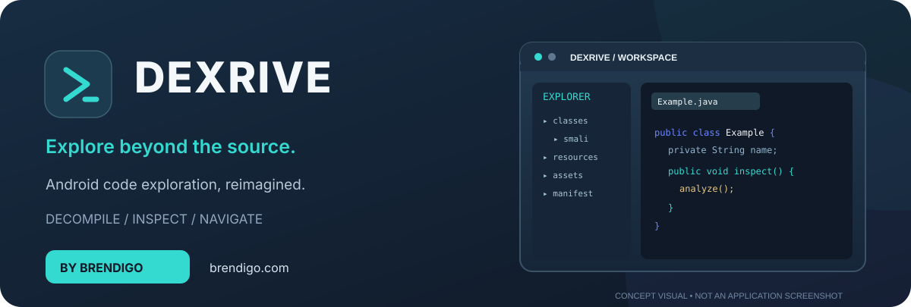
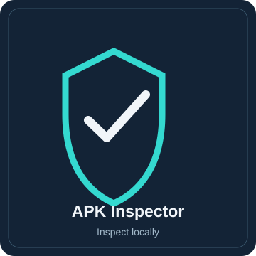
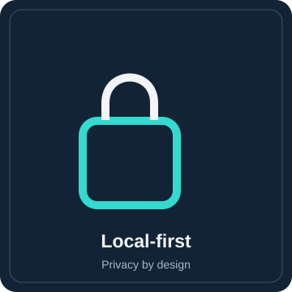
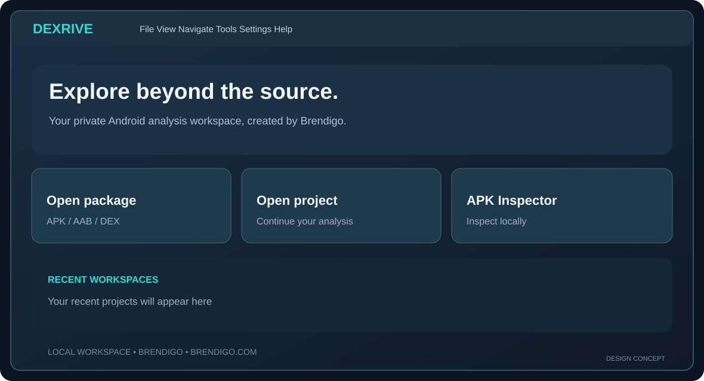

<strong>DEXRIVE</strong> · <a href="https://brendigo.com">brendigo.com</a> · <a href="https://github.com/bren-wp/DEXRIVA/releases">Downloads</a> · <a href="docs/BRAND_GUIDELINES.md">Brand guide</a>

# DEXRIVE — Explore beyond the source.

**By Brendigo.** An elegant, local-first workspace for exploring Android packages, resources, and bytecode. Original brand, interface artwork, packaging and product enhancements developed for DEXRIVE by Brendigo.

**Release status:** The Windows v1.1.0 product build is being verified; availability depends on the GitHub Release artifacts. This migration branch is updating Gradle modules and source layout. The illustrations below are *design concepts*, not screenshots of a running release.

<table>
<tr>
<td width="33%" align="center"><b>APK Inspector</b>
Inspect ZIP headers, DEX entries and native libraries locally.
</td>
<td width="33%" align="center"><b>Code Explorer</b>
Navigate Java classes, references, packages and Android resources.
</td>
<td width="33%" align="center"><b>Local-first</b>
Use desktop analysis features without uploading project content.
</td>
</tr>
</table>

## Design preview

*Illustrative UI composition, **not an actual application screenshot**. Real Windows UI screenshots require capture from a running build and visual review.*

## Features

- **Android decompilation:** explore DEX and APK source representations with the integrated open-source engine.
- **Code intelligence:** search classes, text and references, review source tabs, annotations and available deobfuscation.
- **Resources and manifests:** browse package content, XML and supported resource formats.
- **Offline APK Inspector:** count ZIP entries, DEX files, native libraries and suspicious archive paths locally. This is not a malware scanner or signing verification.
- **Desktop experience:** branded dark UI, original SVG icons, responsive landing workspace and native Windows packaging.
- **Android preview:** a separate, minimal Kotlin/Jetpack Compose APK Inspector under android-inspector/.

## Windows editions

| Edition | Installation and behavior |
| --- | --- |
| **Setup.exe** | DEXRIVE-branded welcome screen, Apache 2.0 license acceptance, directory choice, optional shortcuts and uninstall support |
| **Portable.exe** | No setup wizard, shortcut or registry writes. Unpacks beside the launcher on first run, then opens the app. |

Both bundle a compatible Java runtime. The installer and portable files are built and tested via GitHub Actions before release. **New DEXRIVE 1.1.0 executables are not yet published.** The existing Windows binaries are unsigned (no Authenticode certificate).

## Brand identity

| Property | Identity |
| --- | --- |
| Product | **DEXRIVE** |
| Brand author and product maintainer | **Brendigo** |
| Website | **[brendigo.com](https://brendigo.com)** |
| Slogan | **Explore beyond the source.** |
| Primary colors | Midnight #101927 · Aqua #34D9D0 · Cloud #F1F5F9 |
| Design assets | [Launcher icon](assets/dexrive-mark.svg), [Hero banner](assets/dexrive-banner.svg), [Workspace concept](assets/dexrive-workspace-concept.svg) |

The product brand and newly authored visuals are Brendigo's work. They do not assert sole copyright over the incorporated decompilation engine.

## Build from source

Requires **JDK 21** for desktop builds. Run:

    ./gradlew :dexrive-gui:test :dexrive-core:test
    ./gradlew :dexrive-gui:run

All major Gradle modules and source repository top-level folders use `dexrive-*` names. Historical Java namespaces and selected runtime identifiers remain for binary compatibility. See [migration notes](docs/MODULE_MIGRATION.md). User-facing product naming is DEXRIVE.

## Privacy and security

Archive inspection reads local ZIP metadata without extracting or executing the APK. Decompilation input is untrusted; run suspicious applications or archives in an isolated environment. The tool cannot guarantee exact original Java source recovery, and metadata heuristics are **not** evidence of malware or a cryptographic signature check. User-visible GitHub prompts from the original application are removed from the DEXRIVE UI.

## Legal, notices and credits

**Original DEXRIVE branding and custom product materials: © 2026 Brendigo.** See [BRAND_NOTICE.md](BRAND_NOTICE.md).

DEXRIVE includes software derived from the open-source JADX project by skylot and other contributors under Apache License 2.0. Their required rights and notices are retained in [LICENSE](LICENSE) and [NOTICE](NOTICE). The original project is credited for its underlying engine. DEXRIVE is a separate product and is not an official upstream release.

Original bundled dependencies may have their own licenses. This notice does not erase their author names, copyright headers or permitted rights.
